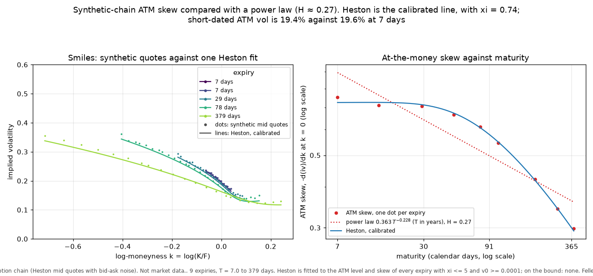
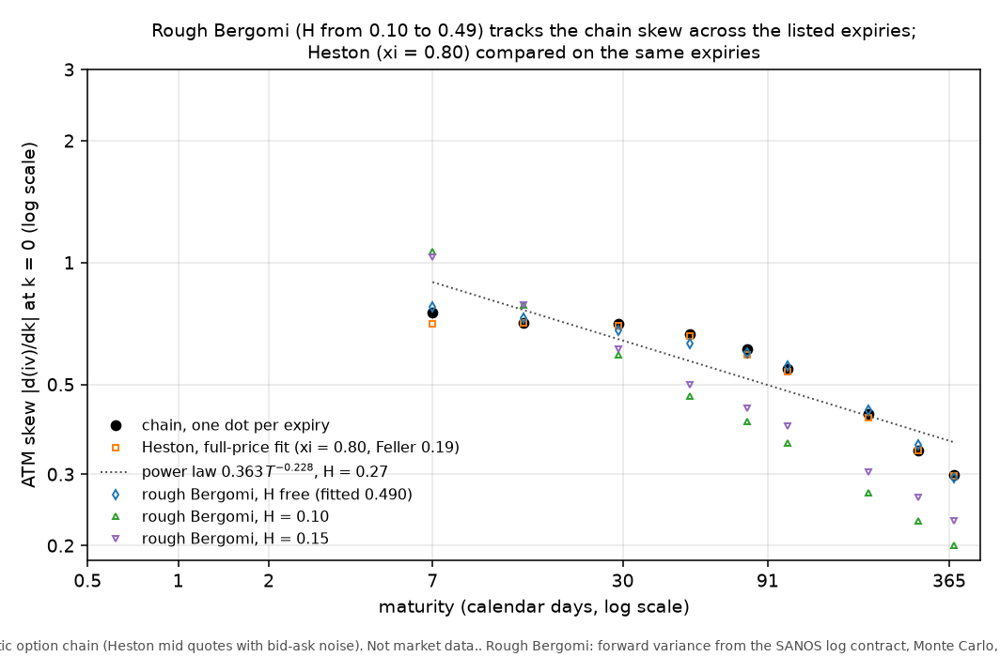

# volsurface

A Python library that turns an option chain into an implied volatility surface
and prices it under Black-Scholes, Heston, SABR, local volatility and rough
Bergomi through one interface. This is a personal research project in
mathematical finance.

Committed figures and tables are built from a **synthetic** option chain
(Heston mid quotes with bid-ask noise, spot 100). They are labelled as such
and are not market data. A fetch script is included so you can run the same
code on a chain you supply; those outputs stay local.

Every number on this page is printed by a script in this repository;
`make reproduce` rebuilds the environment, runs the tests and redraws the
first figure. [LOG.md](LOG.md) records what each session found, dated.



**How to read this.** The left panel shows implied-volatility smiles at five
expiries (dots) against one Heston model (lines), both on the synthetic
demo chain. The right panel shows the at-the-money skew, the slope of implied
vol in log-moneyness, for every expiry on log-log axes, where a power law is a
straight line. In a diffusion model such as Heston (1993) the at-the-money
skew tends to a finite limit as $T \to 0$, $\rho\xi / (4\sqrt{v_0})$, and the
at-the-money vol tends to $\sqrt{v_0}$. Rough volatility models instead
predict a short-maturity skew of order $T^{H-1/2}$ (Alòs, León and Vives 2007;
Fukasawa 2011; Bayer, Friz and Gatheral 2016). The figure is a demonstration
on synthetic quotes, not a market result.



**How to read this.** Black dots are the synthetic-chain skews; the open
markers are a Heston fit to option prices (not to the skew) and rough Bergomi
calibrated to the at-the-money level and skew with $H$ free, and with $H$
fixed at 0.10 and at 0.15 (a typical realised-volatility range, not an
implied-skew estimate from market quotes). The rough Bergomi skews are Monte
Carlo estimates (the script's path count and seed are in the footer). This
panel is also a synthetic demonstration.

## What is in the library

| Path | Contents |
|---|---|
| `volsurface/bs.py`, `volsurface/models/bs.py`, `models/gbm.py` | Black-Scholes in forward form, Greeks, vectorised implied vol; GBM Monte Carlo |
| `volsurface/models/heston.py`, `volsurface/heston.py` | Heston: Lewis (2001) Fourier prices, the COS method of Fang and Oosterlee (2008), Euler simulation |
| `volsurface/models/sabr.py` | SABR with the Hagan et al. (2002) expansion |
| `volsurface/models/localvol.py` | Dupire (1994) local volatility |
| `volsurface/surface/` | Implied surfaces: linear, spline, raw SVI (Gatheral 2004), SANOS, discrete local vol |
| `volsurface/fit/` | Calibration: Heston, SABR, SVI, SANOS (arXiv:2601.11209) as a sparse linear programme, rough Bergomi |
| `volsurface/arbitrage/` | Static arbitrage checks: bounds, call spreads, butterflies, calendar order |
| `volsurface/greeks/` | Greeks five ways: analytic, finite difference, pathwise, likelihood ratio, autodiff (torch) |
| `volsurface/dynamic/` | A minimal dynamic SANOS (arXiv:2608.12587) |
| `volsurface/markets/` | Simulated markets with regime switching, a Hamilton filter, and pricers for the regime experiment |
| `volsurface/mc/` | Random number streams and time grids for Monte Carlo |
| `volsurface/chains.py` | Option chains from yfinance or IBKR (Cboe through `scripts/build_cboe_spx_snapshot.py`), snapshots, forwards, market implied vols |
| `volsurface/demo_market.py` | The synthetic demo chain used by committed figures and the session app |
| `volsurface/smile.py` | At-the-money level and skew, power-law fits |
| `volsurface/core/`, `docs/DESIGN.md` | Shared types and protocols; the design document |
| `scripts/`, `docs/figures/` | One script per figure, with the CSV or JSON it printed (synthetic unless you pass `--snapshot`) |
| `sessions/` | marimo apps, one per session |
| `data/snapshots/` | Where a local chain goes (parquet); not redistributed |
| `tests/fixtures/` | A small synthetic chain (Heston prices with noisy quotes) for the tests |

Rough Bergomi itself (the hybrid scheme of Bennedsen, Lunde and Pakkanen 2017) lives in
a separate package, [rough-volatility](https://github.com/coreyjpritchard/rough-volatility),
pinned to its v0.1.0 tag in `pyproject.toml` (commit 65f3f99 in `uv.lock`) and loaded
through a plugin entry point.

## How to reproduce

Python 3.11. Dependencies are pinned in `uv.lock` ([uv](https://docs.astral.sh/uv/)); torch
comes from the CPU wheel index. One command rebuilds the environment, runs the fast tests
and redraws the first figure from the synthetic demo chain:

```bash
make reproduce
# the same by hand:
uv sync --locked --extra dev --extra autodiff
uv run pytest -m "not slow"
uv run python docs/figure_00.py
```

The other figures (`uv run python scripts/figures_p3e.py`, `scripts/figures_p2c.py`,
and so on) also default to the synthetic chain. Pass `--snapshot path/to/chain.parquet`
to run a script on a chain you supply; those outputs go to `data/cache/figures/` and
are not committed.

The interactive app uses a local snapshot when one is present, and the synthetic
demo otherwise:

```bash
uv run marimo run sessions/00_the_smile.py   # sliders, surface, smile
uv run marimo edit sessions/00_the_smile.py  # the same, with the code
```

Plain pip also works (`pip install -e ".[dev]"`, then `pytest -m "not slow"`). Without the
`autodiff` extra the torch tests are skipped rather than failing at collection.

GitHub Actions runs `ruff check` and the fast tests on every push to `main` and on pull
requests (`.github/workflows/ci.yml`); the slow tests are run by hand.

Build a local snapshot (git ignores everything in `data/snapshots/` but its README):

```bash
python scripts/build_cboe_spx_snapshot.py _SPX.json   # a saved copy of Cboe's delayed SPXW quotes
python -m volsurface.chains yfinance SPY              # writes data/snapshots/SPY_<date>.parquet
```

Cboe's delayed quotes are subject to Cboe's terms of use (<https://www.cboe.com/en/terms/>),
and complying with them is up to you. The repository does not redistribute the data, or
results derived from it.

## Next: the regime experiment (draft pre-registration, no results)

[experiments/regime/PREREG.md](experiments/regime/PREREG.md) pins, before any run, a test
of whether a hedging policy trained in one volatility regime transfers to another. The
market is rough Bergomi whose vol-of-vol switches between two values on a Markov chain;
the hedgers (Buehler et al. 2019) live in a separate repository. The draft fixes the
liabilities, instruments, risk measure, the three hypotheses and their multiple-testing
correction. It is a draft and is not frozen, and there are no results yet.

## Honest limits

- Committed figures are demonstrations on a synthetic chain. They are not
  market results.
- The skew is a quadratic fit within $\max(0.15\sqrt{T}, 0.01)$ of the money;
  another window would move the exponent slightly.
- Calibrations are local least squares from seeded starts, not global
  optimisation.
- The yfinance fetcher has no test, and the IBKR test needs a live gateway.

## References

- Alòs, E., León, J. A. and Vives, J. (2007). On the short-time behavior of the implied volatility for jump-diffusion models with stochastic volatility. *Finance and Stochastics* 11(4), 571-589.
- Bayer, C., Friz, P. and Gatheral, J. (2016). Pricing under rough volatility. *Quantitative Finance* 16(6), 887-904.
- Bennedsen, M., Lunde, A. and Pakkanen, M. S. (2017). Hybrid scheme for Brownian semistationary processes. *Finance and Stochastics* 21(4), 931-965.
- Buehler, H., Gonon, L., Teichmann, J. and Wood, B. (2019). Deep hedging. *Quantitative Finance* 19(8), 1271-1291.
- Dupire, B. (1994). Pricing with a smile. *Risk* 7(1), 18-20.
- Fang, F. and Oosterlee, C. W. (2008). A novel pricing method for European options based on Fourier-cosine series expansions. *SIAM Journal on Scientific Computing* 31(2), 826-848.
- Fukasawa, M. (2011). Asymptotic analysis for stochastic volatility: martingale expansion. *Finance and Stochastics* 15(4), 635-654.
- Gatheral, J. (2004). A parsimonious arbitrage-free implied volatility parameterization with application to the valuation of volatility derivatives. Global Derivatives and Risk Management, Madrid.
- Gatheral, J. (2006). *The Volatility Surface: A Practitioner's Guide*. Wiley.
- Gatheral, J. and Jacquier, A. (2014). Arbitrage-free SVI volatility surfaces. *Quantitative Finance* 14(1), 59-71.
- Gatheral, J., Jaisson, T. and Rosenbaum, M. (2018). Volatility is rough. *Quantitative Finance* 18(6), 933-949.
- Hagan, P. S., Kumar, D., Lesniewski, A. S. and Woodward, D. E. (2002). Managing smile risk. *Wilmott Magazine*, September, 84-108.
- Heston, S. L. (1993). A closed-form solution for options with stochastic volatility with applications to bond and currency options. *Review of Financial Studies* 6(2), 327-343.
- Lewis, A. L. (2001). A simple option formula for general jump-diffusion and other exponential Lévy processes. Working paper, OptionCity.net.
- SANOS: arXiv:2601.11209. Dynamic SANOS: arXiv:2608.12587.

## Licence

MIT.

---

<sub>Built with the help of AI coding tools; all results are reproducible from the scripts in this repo.</sub>
