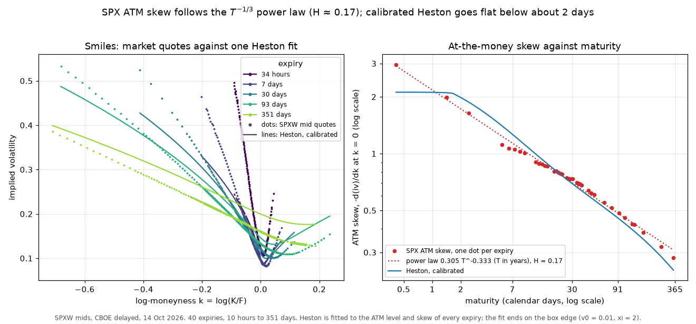
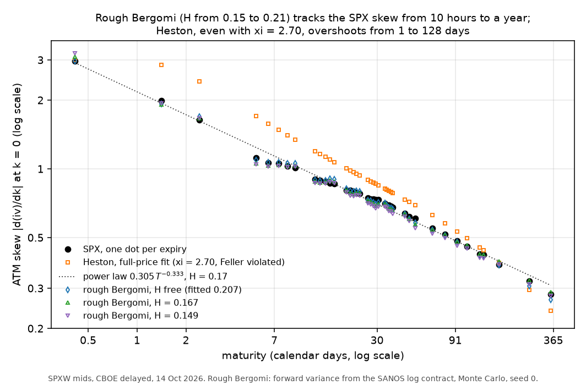
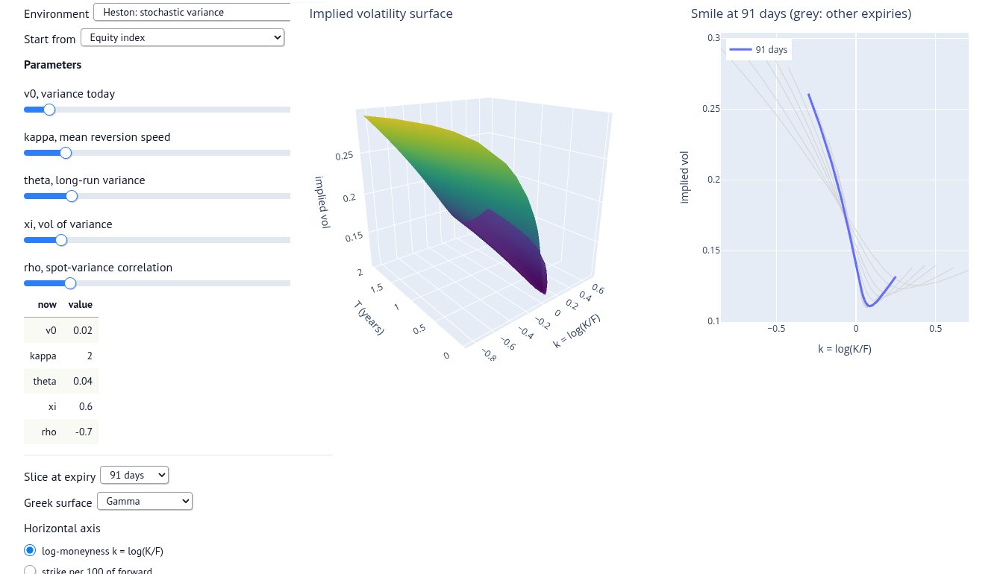
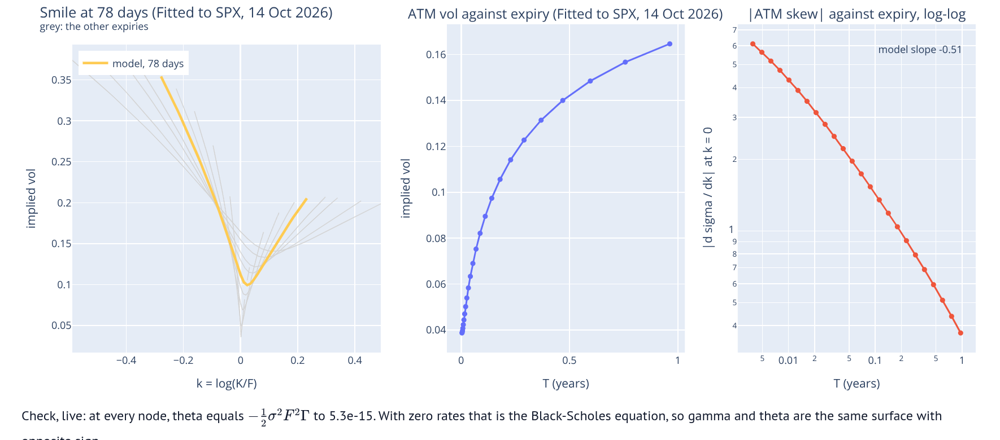
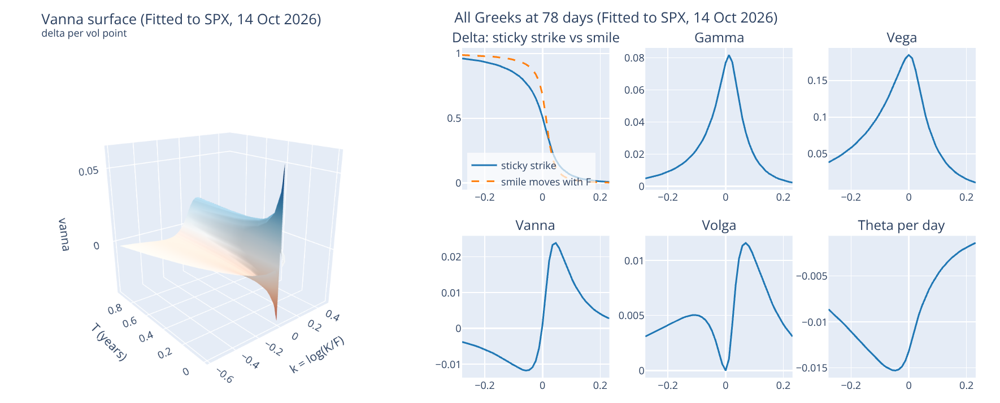

# volsurface

**On the 14 October 2026 SPX option chain (SPXW mid quotes, 40 expiries from 10 hours
to 351 days), the at-the-money skew follows a power law, $|\psi(T)| \approx 0.305\,
T^{-0.333}$. Rough volatility predicts this shape, with Hurst index
$H = 0.5 - 0.333 \approx 0.17$. Fitted to the at-the-money level and skew, Heston can follow
the power law only with its vol-of-vol on whatever upper bound it is given
($\xi = 5$, Feller ratio 0.05), and then its short-dated at-the-money vol is far too low
(5.6% against the market's 15.1% at 10 hours).** A rough Bergomi model with three
parameters, on a forward variance curve read from the same chain, matches the skew at all
40 expiries to within 5.2%.

This is a personal research project in mathematical finance: a Python library that turns
an option chain into an implied volatility surface and prices it under Black-Scholes,
Heston, SABR, local volatility and rough Bergomi through one interface. Every number on
this page is printed by a script in this repository; `make reproduce` rebuilds the
environment, runs the tests and redraws the first figure. [LOG.md](LOG.md) records what
each session found, dated, including the results that did not survive.



**How to read this.** The left panel shows SPXW smiles at five expiries (dots) against one
Heston model (lines); the right panel shows the at-the-money skew, the slope of implied
vol in log-moneyness, for all 40 expiries on log-log axes, where a power law is a straight
line. The market points lie on a line of slope $-1/3$. Rough volatility models predict a
short-maturity skew of order $T^{H-1/2}$ (Alòs, León and Vives 2007; Fukasawa 2011), so
the slope gives $H \approx 0.17$, and rough Bergomi, built on this idea, fits SPX skews well
(Bayer, Friz and Gatheral 2016). In Heston (1993) the variance is a diffusion, so as
$T \to 0$ the at-the-money skew tends to a finite limit, $\rho\xi / (4\sqrt{v_0})$, and the
at-the-money vol tends to $\sqrt{v_0}$. To keep the skew rising down to 10 hours the fit has
to push that limit far above the data (14.4 here), and the cheapest way is a large $\xi$
and a small $v_0$: $\xi$ ends on its bound and $\sqrt{v_0} = 5.4\%$, which is why the
34-hour smile in the left panel dips far below the quotes at the money. The caveat: this
is one snapshot, and the Heston optimum is bound-limited. With $\xi \le 10$ the fit moves
again ($\xi$ on the new bound, Feller ratio 0.03, cost 0.020 against 0.066) and its
10-hour at-the-money vol is still only 7.0%, so the failure is the level-skew trade-off,
not a missing local minimum.



**How to read this.** Black dots are the market skews again; the open markers are a
Heston fit to option prices (not to the skew) and rough Bergomi calibrated to the
at-the-money level and skew with $H$ free (fitted $H = 0.207$), and with $H$ fixed at
0.167 and at 0.149. Rough Bergomi tracks the market from 10 hours to a year: the free-$H$
fit is within 5.2% of the market skew at every expiry (median 1.8%), with three
parameters plus a forward variance curve read off the market. The price-fitted Heston
needs $\xi = 2.70$ (Feller ratio 0.14) to reach the 10-hour skew and then overshoots by more
than 5% from 1.4 to 128 days (by up to 52%, at 5 days). In Heston the skew is roughly
constant for maturities well below $1/\kappa$ and decays like $1/T$ well above it (Gatheral
2006); with one mean-reversion speed ($1/\kappa \approx 27$ days here) it cannot decay like
$T^{-1/3}$ over three orders of magnitude in maturity. Caveats: the rough Bergomi skews
are Monte Carlo estimates (4,000 paths, 64 steps, seed 0) with no error bars drawn,
the fitted at-the-money level is up to 2.4 vol points above the market at the front, and
$H = 0.21$ from one day's option prices is not the $H \approx 0.1$ that
Gatheral, Jaisson and Rosenbaum (2018) estimate from realised volatility time series.

Earlier versions of the first figure reported a Heston fit with $\rho = -0.533$ and a
10-hour skew of 1.87, and then $\rho = -0.551$ and 2.12, both in the narrower session box
($v_0 \ge 0.01$, $\xi \le 2$). [docs/notes/heston_fit_old_vs_new.md](docs/notes/heston_fit_old_vs_new.md)
reproduces each version and explains why they differ.

## What is in the library

| Path | Contents |
|---|---|
| `volsurface/bs.py`, `volsurface/models/bs.py`, `models/gbm.py` | Black-Scholes in forward form, Greeks, vectorised implied vol; GBM Monte Carlo |
| `volsurface/models/heston.py`, `volsurface/heston.py` | Heston: Lewis (2001) Fourier prices, the COS method of Fang and Oosterlee (2008), Euler simulation |
| `volsurface/models/sabr.py` | SABR with the Hagan et al. (2002) expansion |
| `volsurface/models/localvol.py` | Dupire (1994) local volatility |
| `volsurface/surface/` | Implied surfaces: linear, spline, raw SVI (Gatheral 2004), SANOS, discrete local vol |
| `volsurface/fit/` | Calibration: Heston, SABR, SVI, SANOS (arXiv:2601.11209) as a sparse linear programme, rough Bergomi |
| `volsurface/arbitrage/` | Static arbitrage checks: bounds, call spreads, butterflies, calendar order |
| `volsurface/greeks/` | Greeks five ways: analytic, finite difference, pathwise, likelihood ratio, autodiff (torch) |
| `volsurface/dynamic/` | A minimal dynamic SANOS (arXiv:2608.12587) |
| `volsurface/markets/` | Simulated markets with regime switching, a Hamilton filter, and pricers for the regime experiment |
| `volsurface/mc/` | Random number streams and time grids for Monte Carlo |
| `volsurface/chains.py` | Option chains from yfinance or IBKR (CBOE through `scripts/build_cboe_spx_snapshot.py`), snapshots, forwards, market implied vols |
| `volsurface/smile.py` | At-the-money level and skew, power-law fits |
| `volsurface/core/`, `docs/DESIGN.md` | Shared types and protocols; the design document |
| `scripts/`, `docs/figures/` | One script per figure, with the CSV or JSON it printed (SPX quote data as per-expiry summaries only) |
| `sessions/` | marimo apps, one per session |
| `dashboard/`, `volsurface/environments.py` | The volatility environment lab and the library code behind it |
| `data/snapshots/` | Where a local SPX chain goes (parquet); the Cboe snapshot itself is not redistributed |
| `tests/fixtures/` | A small synthetic SPX-like chain (Heston prices with noisy quotes) for the tests |

Rough Bergomi itself (the hybrid scheme of Bennedsen, Lunde and Pakkanen 2017) lives in
a separate package, [rough-volatility](https://github.com/coreyjpritchard/rough-volatility),
pinned to its v0.1.0 tag in `pyproject.toml` (commit 65f3f99 in `uv.lock`) and loaded
through a plugin entry point.

## How to reproduce

The SPX results in this repository were computed on a Cboe delayed-quotes snapshot of
the SPXW chain taken on 14 October 2026. That snapshot is not redistributed here; see
[data/snapshots/README.md](data/snapshots/README.md) to rebuild one yourself, under Cboe's
terms. The tests do not need it: they run on a synthetic chain in `tests/fixtures/`, and the
few that check numbers of the real file are skipped without it. The figure scripts and
`docs/figure_00.py` stop with a message pointing to the build script when there is no
local snapshot. The committed figures and their CSV and JSON outputs are the ones computed
on the 14 October 2026 file.

Python 3.11. Dependencies are pinned in `uv.lock` ([uv](https://docs.astral.sh/uv/)); torch
comes from the CPU wheel index. One command rebuilds the environment, runs the fast tests
and redraws the first figure (about five minutes, most of it the Heston multi-start):

```bash
make reproduce   # the last step needs a local snapshot
# the same by hand:
uv sync --locked --extra dev --extra autodiff
uv run pytest -m "not slow"
uv run python docs/figure_00.py
```

The other figures: `uv run python scripts/figures_p3e.py` (rough Bergomi, Monte
Carlo), `scripts/figures_p2c.py` (Heston price fit and COS checks), and so on, one script
per figure. `XI_MAX=10 uv run python docs/figure_00.py` reruns the Heston fit with the wider
$\xi$ bound quoted above.

The interactive app:

```bash
uv run marimo run sessions/00_the_smile.py   # sliders, surface, smile
uv run marimo edit sessions/00_the_smile.py  # the same, with the code
```

Plain pip also works (`pip install -e ".[dev]"`, then `pytest -m "not slow"`). Without the
`autodiff` extra the torch tests are skipped rather than failing at collection. Without
Python, download the static export [docs/00_the_smile.html](docs/00_the_smile.html) and
open it in a browser (GitHub shows the file as source rather than rendering it). The export
leaves out the SPX market point of each quote; its skew figure keeps one SPX skew
per expiry. After re-exporting, `python scripts/strip_export_quotes.py docs/00_the_smile.html`
removes the per-quote points again.

GitHub Actions runs `ruff check` and the fast tests on every push to `main` and on pull
requests (`.github/workflows/ci.yml`); the slow tests are run by hand.

Build a local snapshot (git ignores everything in `data/snapshots/` but its README):

```bash
python scripts/build_cboe_spx_snapshot.py _SPX.json   # a saved copy of Cboe's delayed SPXW quotes
python -m volsurface.chains yfinance SPX              # writes data/snapshots/SPX_<date>.parquet
```

Cboe's delayed quotes are subject to Cboe's terms of use (<https://www.cboe.com/en/terms/>),
and complying with them is up to you. The repository does not redistribute the data.

## Volatility environment lab

```bash
make dashboard        # = uv run --locked --extra dev marimo run dashboard/vol_lab.py
```

A marimo app for playing with volatility models. Pick a model (Black-Scholes with one
flat vol, Heston, SABR, raw SVI, SANOS, or rough Bergomi by Monte Carlo through the
plug-in) and a **Mode**:

- **Synthetic**: you set the parameters with sliders. Nothing is fitted to data. The
  presets include ones built to break: SVI with calendar arbitrage, and SVI and SABR with
  butterfly arbitrage. SANOS has no synthetic version (it is only ever a fit).
- **Fitted**: the same model calibrated to the SPX (SPXW) option chain of 14 October 2026,
  with its implied-vol RMSE, and drawn over the market quotes when the snapshot is on
  disk. For Black-Scholes, Heston and
  rough Bergomi the sliders start at the fitted values and stay editable; "Reset to fit"
  puts them back, and the panel says when they have moved. SABR, SVI and SANOS are fitted
  expiry by expiry and are shown as fitted.

Every view is labelled Synthetic or Fitted, and Fitted views name the underlying, the
index print, the forward treatment and the expiries. Every panel is computed live by the
library; the app holds no pricing code and calibrates nothing
(`volsurface/environments.py` does the work).

The fits are read from two files. `data/presets/spx_fits.npz` holds the SVI and SANOS fits;
`scripts/build_dashboard_presets.py` rebuilds it in about three minutes.
`data/presets/spx_model_fits.json` holds every model's fitted parameters, the forward and
discount factor per expiry, and the fit errors; `scripts/build_model_fits.py` rebuilds it
in about five minutes. Neither file holds an option price or the implied vol of a single
quote. The black dots and the error after a slider moves need the quotes, so the app
rebuilds them from the snapshot in `data/snapshots/` when it is there
(`environments.load_market_quotes`, about a second). Without the snapshot, as in the
static web build, the dots are left out and only the saved errors at the fit are shown.

The data is one snapshot: 8,973 out-of-the-money SPXW mids, 40 expiries from 10 hours to
351 days, CBOE delayed quotes taken at 10:01 UTC on 14 October 2026 (06:01 in New York,
before the cash open, so the index print of 7,805.45 is the previous close). There is no
rate or dividend input: each expiry's forward and discount factor come from put-call
parity on the eight strikes nearest the money, and moneyness is $k = \log(K/F)$ against
that forward. The error is the same for every model: the root mean square of model minus
market implied vol over all the quotes, in vol points (1 point = 0.01 of vol), although
each model was fitted to its own loss.

| Model | How it is fitted | Fitted parameters | RMSE (vol points) |
|---|---|---|---|
| Black-Scholes | One vol for every quote: the mean implied vol | $\sigma$ = 20.3% | 11.34 |
| Heston | At-the-money level and skew of every expiry (as `docs/figure_00.py`), 35 starts | $v_0$ = 0.00287, $\kappa$ = 8.72, $\theta$ = 0.0642, $\xi$ = 5.00 (on its bound), $\rho$ = −0.625 | 3.35 |
| SABR | Per expiry, $\beta$ = 1 fixed, vega-weighted prices | one $(\alpha, \rho, \nu)$ per expiry | 4.04 |
| Raw SVI | Per expiry (the saved fit) | five per expiry | 0.39 |
| SANOS | Arbitrage-free fit (the saved fit) | | 0.13 |
| Rough Bergomi | At-the-money level and skew, $H$ free, forward variance from SANOS | $H$ = 0.207, $\eta$ = 2.35, $\rho$ = −0.657 | 2.06 (Monte Carlo) |

Read the table with its caveats. Heston's $\xi$ sits on the upper bound of 5 of the box
and the loss has no interior optimum in $\xi$, so a wider box moves $\xi$ to the new
bound; these are not well-identified parameters. SABR's error is mostly the shortest
expiries: $\nu$ ends on its bound of 4 on every expiry out to 21 days, and $\rho$ on
−0.999 on the first three (to 2.4 days). One SABR smile cannot bend as sharply as SPX
does a few days out; from 20 days on each expiry is within about one vol point. SVI and SANOS have many more parameters than the others, so their lower
errors are not like for like. The rough Bergomi figures are Monte Carlo (4,000 paths,
seed 0) and leave out the 1,332 deep out-of-the-money quotes whose prices are too small
for the paths to resolve. This is one morning of one index; nothing here says how these
fits behave on another day.



**How to read this.** Heston in Fitted mode, as the static web build shows it (fitted
parameters only, no quotes). Left: the Mode switch, the model, the sliders at the fitted
values with the table of their values to four figures, "Reset to fit", and the fit error:
3.35 vol points over 8,918 of the 8,973 quotes, and 2.34 at the 78-day expiry. Right:
Black implied vol over log-moneyness $k = \log(K/F)$ and expiry; in Fitted mode the rows
are nine of the quoted SPX expiries, from 1.4 days out to 351 days, each spanning the same
number of standard deviations. Run locally with the snapshot on disk, the same view also
draws the quotes as black dots. The takeaway is the shape Heston can reach on this chain:
a steep short-dated skew that flattens with expiry. What it does not show: the
arbitrage checks (the status line below the controls) are pointwise on the grid, so a
pass says nothing between nodes, and a fit to one morning says nothing about another day.



**How to read this.** Below the surface, for the same fitted Heston. Left: the smile at the
chosen expiry (78 days, yellow) with the other grid expiries in grey. Middle: the
at-the-money vol against expiry. Right: the absolute at-the-money skew against expiry on
log-log axes, with the fitted slope (here -0.51, a skew decaying like $1/\sqrt T$ over this
range). The takeaway is that each parameter has a fingerprint: in Heston, $\rho$ tilts the
smile, $\xi$ bends it, and $\kappa$ sets where the skew stops being flat and starts
decaying like $1/T$, so the log-log skew line bends; in rough Bergomi it stays straight
with slope $H - 1/2$. What it does not show: the market's own ATM level and skew per expiry
are drawn as black dots only when the snapshot is on disk, and the rough Bergomi lines are
a Monte Carlo estimate (4,000 paths) with no error bars.



**How to read this.** The same fitted Heston. Left: one Greek as a surface over strike and
expiry (here vanna, the change in delta per vol point). Right: delta, gamma, vega, vanna, volga and theta per
day at the chosen expiry. All are Black Greeks at each option's own implied vol, per 100
of forward, with zero rates. Gamma and theta are the same surface with opposite sign
($\Theta = -\tfrac12\sigma^2F^2\Gamma$, checked live in the app), gamma piles up at the
money and at short expiries, vega grows like $\sqrt T$, vanna changes sign across the
money and volga is positive in the wings. The delta panel has two lines: the
sticky-strike Black delta, and the delta when the smile moves with the forward, which is
the model's own delta for Heston and the alpha-fixed Hagan delta for SABR. What it does
not show: these are not minimum-variance hedge ratios, and for the Monte Carlo environment they are Black Greeks
of the Monte Carlo smile, not pathwise model Greeks. `tests/test_environments.py` checks
the Greeks against finite differences and closed forms.

### Static web version

```bash
make public-vollab    # = python scripts/build_public_vollab.py build/public-vollab
python -m http.server -d build/public-vollab
```

The same app as one static folder that runs entirely in the visitor's browser (Pyodide,
through `marimo export html-wasm`), with no server behind it. It ships the `volsurface`
wheel, a slimmed plotly wheel, `data/presets/spx_fits.npz` and
`data/presets/spx_model_fits.json`, and by default it also self-hosts the Pyodide runtime
and its packages, so the page requests nothing from any other host (`--cdn` loads the
runtime from public CDNs instead). Fitted mode reads the precomputed fits from those two
files: the browser never calibrates and never fetches market data. Every model works in
both modes except rough Bergomi, which needs the separate rough-volatility package and
shows a note to clone this repository instead.

The folder holds two pages that share one runtime: the desktop page at the root and a
phone page in `m/` (`dashboard/vol_lab_mobile.py`): the same Mode switch and models, one
column, the parameters in a collapsible panel, a Synthetic or Fitted label on every tab, and one view at a time behind tabs (surface, smile, term structure,
Greeks with a picker, arbitrage) on a coarser grid. Screens narrower than 760 px are sent
to `m/`; each page links to the other, and the choice of the desktop page is remembered.
While it loads, both pages show a plain HTML loading screen (`scripts/public_vollab/`)
that paints before any script runs: what the lab is, what the first visit downloads, the
current stage, and a bar of the megabytes the Python worker has fetched so far. It gives
way to the app when the first plot appears, and offers a retry and the repository link if
a download fails or nothing moves for two minutes.

The folder is about 72 MB. A first visit downloads about 57 MB (about 42 MB if the host
compresses it) and shows the first plots after about 13 to 15 seconds on a fast link,
23 seconds at 50 Mbit/s and a minute at 10 Mbit/s; later moves take under a second on the
phone page and one to three seconds on the desktop page.

## Next: the regime experiment (draft pre-registration, no results)

[experiments/regime/PREREG.md](experiments/regime/PREREG.md) pins, before any run, a test
of whether a hedging policy trained in one volatility regime transfers to another. The
market is rough Bergomi whose vol-of-vol switches between two values on a Markov chain;
the hedgers (Buehler et al. 2019) live in a separate repository. The draft fixes the
liabilities, instruments, risk measure, the three hypotheses and their multiple-testing
correction. It is a draft and is not frozen, and there are no results yet.

## Honest limits

- One snapshot. Every SPX number here comes from one chain, taken at 06:01 New York time on
  14 October 2026, in the overnight (global trading hours) session before the cash open,
  not in the cash session.
- The skew is a quadratic fit within $\max(0.15\sqrt{T}, 0.01)$ of the money; another
  window would move the exponent slightly.
- Calibrations are local least squares from seeded starts, not global optimisation. The
  headline Heston fit ends on its $\xi$ bound, and $\kappa$ is poorly identified (8.0 to
  10.8 across the starts that end within 1% of the best cost).
- Because that fit sits in a flat valley in $\kappa$, the last digits of the first figure's
  numbers (the Feller ratio, the short-skew limit) can differ slightly from machine to
  machine with the linear algebra library and thread count (Feller 0.045 against 0.046,
  limit 14.4 against 14.6, on two Linux machines); the conclusions do not.
- Raw SVI fitted slice by slice is not free of static arbitrage on this chain: 2,246
  violations on the check grid, against 0 for SANOS (`docs/figures/p3c_shootout.csv`).
- The yfinance fetcher has no test, and the IBKR test needs a live gateway.

## References

- Alòs, E., León, J. A. and Vives, J. (2007). On the short-time behavior of the implied volatility for jump-diffusion models with stochastic volatility. *Finance and Stochastics* 11(4), 571-589.
- Bayer, C., Friz, P. and Gatheral, J. (2016). Pricing under rough volatility. *Quantitative Finance* 16(6), 887-904.
- Bennedsen, M., Lunde, A. and Pakkanen, M. S. (2017). Hybrid scheme for Brownian semistationary processes. *Finance and Stochastics* 21(4), 931-965.
- Buehler, H., Gonon, L., Teichmann, J. and Wood, B. (2019). Deep hedging. *Quantitative Finance* 19(8), 1271-1291.
- Dupire, B. (1994). Pricing with a smile. *Risk* 7(1), 18-20.
- Fang, F. and Oosterlee, C. W. (2008). A novel pricing method for European options based on Fourier-cosine series expansions. *SIAM Journal on Scientific Computing* 31(2), 826-848.
- Fukasawa, M. (2011). Asymptotic analysis for stochastic volatility: martingale expansion. *Finance and Stochastics* 15(4), 635-654.
- Gatheral, J. (2004). A parsimonious arbitrage-free implied volatility parameterization with application to the valuation of volatility derivatives. Global Derivatives and Risk Management, Madrid.
- Gatheral, J. (2006). *The Volatility Surface: A Practitioner's Guide*. Wiley.
- Gatheral, J. and Jacquier, A. (2014). Arbitrage-free SVI volatility surfaces. *Quantitative Finance* 14(1), 59-71.
- Gatheral, J., Jaisson, T. and Rosenbaum, M. (2018). Volatility is rough. *Quantitative Finance* 18(6), 933-949.
- Hagan, P. S., Kumar, D., Lesniewski, A. S. and Woodward, D. E. (2002). Managing smile risk. *Wilmott Magazine*, September, 84-108.
- Heston, S. L. (1993). A closed-form solution for options with stochastic volatility with applications to bond and currency options. *Review of Financial Studies* 6(2), 327-343.
- Lewis, A. L. (2001). A simple option formula for general jump-diffusion and other exponential Lévy processes. Working paper, OptionCity.net.
- SANOS: arXiv:2601.11209. Dynamic SANOS: arXiv:2608.12587.

## Licence

MIT.

---

<sub>Built with the help of AI coding tools; all results are reproducible from the scripts in this repo.</sub>
